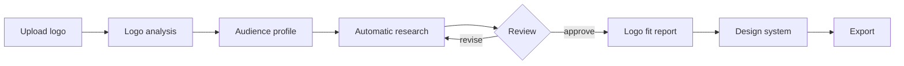

<div align="center">


### Generate a complete design system from a logo.

<br />


 
[Why](#why-mrdesignmd) · [Screenshots](#screenshots) · [Pipeline](#pipeline) · [Getting started](#getting-started) · [Deployment](#deployment) · [API](#api) · [Troubleshooting](#troubleshooting)


</div>

---

## Why MrDesign.md

Most design systems begin with a blank page and a guess at a color palette. MrDesign.md begins with the one asset a brand already has — its logo — and works outward from it:

1. The logo is analyzed for its color signature, style and mood.
2. You describe the product's audience, platform and trust requirements.
3. The system researches the audience's domain and trust psychology. You review and approve the findings before anything is generated.
4. A fit report scores how well the logo suits that domain and suggests changes if it does not.
5. A color-theory palette, typography and component tokens are generated and shown in a live preview.
6. Everything is exported as a portable package — including a `DESIGN.md` that drops straight into your editor.

**What makes it different**

- **Analysis you can verify.** Pixel-level palette extraction is combined with VLM naming of colors, style tags, mood and trust signals — every claim is traceable to the pixels.
- **Research with a review gate.** Generation never starts until you approve the research. Edit any section inline before approving.
- **Logo fit report.** A match score, detected issues and suggestions — plus a ready-to-paste image-tool prompt for upgrading a logo that clashes with the domain.
- **Live preview with style directions.** The generated tokens drive real components (hero, buttons, badges, forms) in light and dark variants, with optional style features like Liquid Glass, ambient finishes and cursor packs.
- **Visual and spec editing.** Adjust tokens in a visual editor or edit the `DESIGN.md` spec directly — both stay in sync.
- **Bring-your-own-key.** On public deployments every visitor uses their own AI key, stored only in their browser. Strangers never spend your credits.
- **Works without an AI key.** The "Want a prompt?" flows generate a copy-paste prompt block; an external assistant fills it in and you paste the result back.

---

## Screenshots

| | |
| --- | --- |
|  |  |
| **Start from a logo** | **Color signature, style tags and mood** |
|  |  |
| **Audience research you approve** | **Theme directions and style features** |
|  |  |
| **Every token applied to real components** | **Download the full brand package** |

---

## Pipeline



| Step | Stage | Description |
| :-: | --- | --- |
| 1 | Upload logo | Pixel-extracted palette and VLM naming (colors, style tags, mood, trust signals) |
| 2 | Logo analysis | Review the color signature and style interpretation |
| 3 | Audience | Category, audience, platform, monetization and trust need, saved to the database |
| 4 | Research review | Automatic web research on the audience's domain and trust psychology; approve before generation |
| 5 | Logo fit report | Match score, issues and suggestions if the logo clashes with the domain |
| 6 | Design system | Tokens (palette scale, typography, radius, shadows, buttons), `DESIGN.md`, live preview, visual and spec editing |
| 7 | Export | Full package as a `.zip` |

### What the export contains

```text
<project>-design-package.zip
├── DESIGN.md         Agent-ready design system spec
├── tokens.json       Structured design tokens
├── metadata.json     Project, audience, research and analysis metadata
├── logo.*            Original logo file
└── brand-sheet.svg   Palette and type samples as SVG
```

---

## Tech stack

| Layer | Technology |
| --- | --- |
| Framework | [Next.js 16](https://nextjs.org/) (App Router), [TypeScript](https://www.typescriptlang.org/) |
| Styling | [Tailwind CSS 4](https://tailwindcss.com/), [shadcn/ui](https://ui.shadcn.com/) |
| Database | PostgreSQL ([Prisma Postgres](https://www.prisma.io/postgres)) through [Prisma ORM](https://www.prisma.io/orm) |
| AI | [Z.AI Open Platform](https://z.ai/) (GLM models) through a small in-house REST client — VLM logo analysis, LLM design and research, web search |
| Tooling | [Bun](https://bun.sh/) |
| Hosting | [Vercel](https://vercel.com/) |

---

## Getting started

### Prerequisites

- [Bun](https://bun.sh/)
- A PostgreSQL database, such as [Prisma Postgres](https://www.prisma.io/postgres)
- A Z.AI API key (free tier available on the [Z.AI Open Platform](https://z.ai/manage-apikey/apikey-list))

### Run locally

```bash
git clone https://github.com/mrshah-xo/mrdesign.md.git
cd mrdesign.md

cp .env.example .env     # add your Prisma Postgres credentials
bun install
bun run db:push          # sync the schema to the database
bun run dev              # http://localhost:3000
```

Locally you can skip the environment variables by putting your AI credentials in a gitignored `.ai-credentials.json` at the project root:

```json
{ "baseUrl": "https://api.z.ai/api/paas/v4", "apiKey": "..." }
```

The file can also point at a mounted secret — `{ "credentialsFile": "/run/secrets/ai_gateway.json" }` — which is re-read on rotation, so long-running servers pick up fresh tokens without a restart.

> [!TIP]
> No AI key at all? The app still works end-to-end for free: the "Want a prompt?"
> flows on the brief and research steps generate a copy-paste prompt block, an
> external assistant fills it in, and you paste the result back.

---

## Deployment

### Vercel

1. Push the repository to GitHub and import it in Vercel.
2. Under **Project > Settings > Environment Variables**, set:

   | Variable | Value |
   | --- | --- |
   | `DATABASE_URL` | Pooled Prisma Postgres URL (`pooled.db.prisma.io`), recommended for serverless |
   | `DATABASE_URL_POOLED` | Same pooled URL (reference) |
   | `POSTGRES_URL`, `PRISMA_DATABASE_URL` | Direct URL (reference) |
   | `ZAI_BASE_URL` | `https://api.z.ai/api/paas/v4` |
   | `ZAI_API_KEY` | Your Z.AI API key |
   | `ZAI_CHAT_ID`, `ZAI_USER_ID`, `ZAI_TOKEN` | Optional gateway fields |
   | `ZAI_TEXT_MODEL` | Optional. Set `glm-4.5-flash` to run research/DESIGN generation on the **free** text model |
   | `ZAI_VISION_MODEL` | Optional. Overrides the logo-analysis vision model (default `glm-4.6v`) |
   | `ZAI_ALLOW_OWNER_KEY` | Optional. Set `1` to let public visitors use your `ZAI_API_KEY`. **Default is off** |

   **Bring-your-own-key (default on production):** visitors paste their own Z.AI API key
   through the "API keys" panel in the header (generate one free at
   [z.ai/manage-apikey/apikey-list](https://z.ai/manage-apikey/apikey-list)). The key is stored
   only in the visitor's browser (localStorage), sent per-request in the `x-user-key` header,
   and used exclusively for that visitor's generations — it is never persisted server-side.
   Your `ZAI_API_KEY` then serves **only** local development, unless you set
   `ZAI_ALLOW_OWNER_KEY=1`. Requests without a key receive `401 { requiresUserKey: true }`
   and the UI opens the panel automatically.

   **Notes:**
   - Live web search uses the platform's function bridge. Endpoints without a
     `functions/invoke` route still work — research degrades gracefully and
     generates the report without live citations.
   - Long pipelines run through `after()` (post-response work kept alive) with
     DB-backed job state, so polling survives serverless instance switches.
     Research needs a duration cap of at least 90s and design generation at
     least 120s (defaults exported in each route; Fluid compute supports this
     on all current plans).

3. Apply the schema to the database once, from your machine or a CI step:

   ```bash
   bun run db:push
   ```

4. Deploy. The app reads only `DATABASE_URL` at runtime.

Use the pooled URL for `DATABASE_URL` on Vercel. The direct URL is intended for long-running servers.

### Database provider auto-sync

`prisma/schema.prisma`'s datasource `provider` is synced to the protocol of the effective
`DATABASE_URL` automatically (scripts/sync-prisma-provider.mjs, runs before `dev`, `build`
and `db:push`): a SQLite `file:` URL selects `sqlite`, a `postgres://` / `postgresql://`
URL selects `postgresql`. Local development therefore runs on `db/custom.db`, while
Vercel builds automatically compile the client for Prisma Postgres — no manual schema edits.
To point a local checkout at the cloud database again, put the real
`DATABASE_URL=postgres://…` in `.env.local` (gitignored, survives redeploys and restarts) and
restart; the provider flips back to `postgresql` on the next `bun run dev` or `bun run db:push`.

---

## API

| Method | Route | Purpose |
| :-: | --- | --- |
| `GET` | `/api/projects` | List projects |
| `POST` | `/api/projects` | Create a project (multipart logo upload) |
| `GET` | `/api/projects/:id` | Full project state |
| `POST` | `/api/projects/:id/analyze` | Run logo analysis |
| `PUT` | `/api/projects/:id/audience` | Save audience profile |
| `POST` | `/api/projects/:id/research` | Run automatic research |
| `POST` | `/api/projects/:id/research/approve` | Approve research |
| `POST` | `/api/projects/:id/design` | Generate design (async job) |
| `GET` | `/api/projects/:id/design?jobId=` | Poll a design job |
| `PUT` | `/api/projects/:id/design` | Update tokens (visual and spec editor) |
| `GET` | `/api/projects/:id/export` | Download the full package (`.zip`) |

---

## Data migration

To move a legacy local SQLite database (`db/custom.db`) into the cloud database:

```bash
bun scripts/migrate-sqlite-to-pg.ts --sqlite db/custom.db
```

---

## Troubleshooting

<details>
<summary><code>Error validating datasource db: the URL must start with the protocol file:</code></summary>

<br />

The deployment was built from a commit before the PostgreSQL migration, so its Prisma client was generated with `provider = "sqlite"`. Trigger a redeploy on the latest commit. The build runs `prisma generate`, so the client always matches the committed schema.

</details>

<details>
<summary><code>Environment variable not found: DATABASE_URL</code></summary>

<br />

Set `DATABASE_URL` in the Vercel project settings, using the pooled URL (`pooled.db.prisma.io`).

</details>

<details>
<summary>AI features fail on Vercel but work locally</summary>

<br />

On serverless there is no credentials file, so the AI variables must be set in the environment. Add `ZAI_BASE_URL` and `ZAI_API_KEY` (plus any optional `ZAI_*` fields) in the Vercel project settings and redeploy.

</details>

---

## Security

Secrets are never committed. `.env` and `.ai-credentials.json` are git-ignored; use `.env.example` as the template and keep real credentials in your host's environment settings. Visitor keys live only in the visitor's browser.

## Contributing

Issues and pull requests are welcome. For larger changes, please open an issue first to discuss the approach.

## License

MIT — see [`LICENSE`](LICENSE).

---

<div align="center">
<br />

<br />
<sub> Design without compromise.<br> If it is useful or save your time just give one ⭐</sub>
</div>


