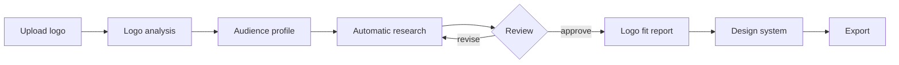

<div align="center">


# DesignForge

**Generate a complete design system from a logo.**

Upload a logo, describe the audience, and DesignForge produces a `DESIGN.md`, design tokens, a live component preview and an export package. Palette decisions come from the logo's actual pixels and from audience research, not from defaults.

<br />


[Overview](#overview) | [Pipeline](#pipeline) | [Getting started](#getting-started) | [Deployment](#deployment) | [API](#api) | [Troubleshooting](#troubleshooting)

</div>

---

## Overview

Most design systems begin with a blank page and a guess at a color palette. DesignForge begins with the one asset a brand already has, its logo, and works outward from it.

1. The logo is analyzed for its color signature, style and mood.
2. You describe the product's audience, platform and trust requirements.
3. The system researches the audience's domain and trust psychology. You review and approve the findings before anything is generated.
4. A fit report scores how well the logo suits that domain and suggests changes if it does not.
5. A color-theory palette, typography and component tokens are generated and shown in a live preview.
6. Everything is exported as a portable package.

### Key capabilities

- **Pixel-level palette extraction** combined with VLM naming of colors, style tags, mood and trust signals.
- **Audience research with a review gate.** Generation never starts until the research is approved.
- **Logo fit report** with a match score, detected issues and suggestions.
- **Domain-aware preview.** Components render with copy that fits the audience's domain.
- **Visual and spec editing.** Adjust tokens in a visual editor or edit the spec directly.
- **Persistent storage.** Projects, analyses, audience profiles, research reports and design specs are stored in PostgreSQL and survive across deployments and machines.

---

## Pipeline



| Step | Stage | Description |
| :-: | --- | --- |
| 1 | Upload logo | Pixel-extracted palette and VLM naming (colors, style tags, mood, trust signals) |
| 2 | Logo analysis | Review the color signature and style interpretation |
| 3 | Audience | Category, audience, platform, monetization and trust need, saved to the database |
| 4 | Research review | Automatic web research on the audience's domain and trust psychology; approve before generation |
| 5 | Logo fit report | Match score, issues and suggestions if the logo clashes with the domain |
| 6 | Design system | Tokens (palette scale, typography, radius, shadows, buttons), `DESIGN.md`, live preview, visual and spec editing |
| 7 | Export | Full package as a `.zip` |

### Export contents

```text
designforge-export.zip
├── DESIGN.md        Design system specification
├── tokens.json      Design tokens
├── metadata.json    Project, audience and analysis metadata
└── logo.*           Original logo file
```

---

## Tech stack

| Layer | Technology |
| --- | --- |
| Framework | Next.js 16 (App Router), TypeScript |
| Styling | Tailwind CSS 4, shadcn/ui |
| Database | PostgreSQL (Prisma Postgres) through Prisma ORM |
| AI | `z-ai-web-dev-sdk` for VLM logo analysis, LLM design and research, and web search |
| Tooling | Bun |
| Hosting | Vercel |

---

## Getting started

### Prerequisites

- [Bun](https://bun.sh/)
- A PostgreSQL database, such as [Prisma Postgres](https://www.prisma.io/postgres)
- Z.AI credentials at `/etc/.z-ai-config`

### Run locally

```bash
git clone https://github.com/mrshah-xo/designforge.git
cd designforge

cp .env.example .env     # add your Prisma Postgres credentials
bun install
bun run db:push          # sync the schema to the database
bun run dev              # http://localhost:3000
```

Locally, the AI features read Z.AI credentials from `/etc/.z-ai-config` automatically, so no additional environment variables are required.

---

## Deployment

### Vercel

1. Push the repository to GitHub and import it in Vercel.
2. Under **Project > Settings > Environment Variables**, set:

   | Variable | Value |
   | --- | --- |
   | `DATABASE_URL` | Pooled Prisma Postgres URL (`pooled.db.prisma.io`), recommended for serverless |
   | `DATABASE_URL_POOLED` | Same pooled URL (reference) |
   | `POSTGRES_URL`, `PRISMA_DATABASE_URL` | Direct URL (reference) |
   | `ZAI_BASE_URL` | Z.AI gateway base URL, from `.z-ai-config` |
   | `ZAI_API_KEY` | Z.AI API key, from `.z-ai-config` |
   | `ZAI_CHAT_ID`, `ZAI_USER_ID`, `ZAI_TOKEN` | Optional remaining fields from `.z-ai-config` |

   The AI features (logo analysis, research, design generation) require the `ZAI_*` variables on Vercel because there is no config file on the serverless filesystem.

3. Apply the schema to the database once, from your machine or a CI step:

   ```bash
   bun run db:push
   ```

4. Deploy. The app reads only `DATABASE_URL` at runtime.

Use the pooled URL for `DATABASE_URL` on Vercel. The direct URL is intended for long-running servers.

---

## API

| Method | Route | Purpose |
| :-: | --- | --- |
| `GET` | `/api/projects` | List projects |
| `POST` | `/api/projects` | Create a project (multipart logo upload) |
| `GET` | `/api/projects/:id` | Full project state |
| `POST` | `/api/projects/:id/analyze` | Run logo analysis |
| `PUT` | `/api/projects/:id/audience` | Save audience profile |
| `POST` | `/api/projects/:id/research` | Run automatic research |
| `POST` | `/api/projects/:id/research/approve` | Approve research |
| `POST` | `/api/projects/:id/design` | Generate design (async job) |
| `GET` | `/api/projects/:id/design?jobId=` | Poll a design job |
| `PUT` | `/api/projects/:id/design` | Update tokens (visual and spec editor) |
| `GET` | `/api/projects/:id/export` | Download the full package (`.zip`) |

---

## Data migration

To move a legacy local SQLite database (`db/custom.db`) into the cloud database:

```bash
bun scripts/migrate-sqlite-to-pg.ts --sqlite db/custom.db
```

---

## Troubleshooting

<details>
<summary><code>Error validating datasource db: the URL must start with the protocol file:</code></summary>

<br />

The deployment was built from a commit before the PostgreSQL migration, so its Prisma client was generated with `provider = "sqlite"`. Trigger a redeploy on the latest commit. The build runs `prisma generate`, so the client always matches the committed schema.

</details>

<details>
<summary><code>Environment variable not found: DATABASE_URL</code></summary>

<br />

Set `DATABASE_URL` in the Vercel project settings, using the pooled URL (`pooled.db.prisma.io`).

</details>

<details>
<summary>AI features fail on Vercel but work locally</summary>

<br />

Locally the SDK reads `/etc/.z-ai-config`, which does not exist on serverless. Add `ZAI_BASE_URL` and `ZAI_API_KEY` (plus any optional `ZAI_*` fields) in Vercel and redeploy.

</details>

---

## Security

Secrets are never committed. `.env` is git-ignored; use `.env.example` as the template and keep real credentials in your host's environment settings.

## Contributing

Issues and pull requests are welcome. For larger changes, please open an issue first to discuss the approach.

## License

See [`LICENSE`](LICENSE).
