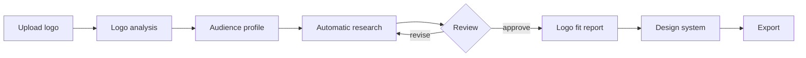

<div align="center">


**Generate a complete design system from a logo.**


<br />


[Overview](#overview) | [Pipeline](#pipeline) | [Getting started](#getting-started) | [Deployment](#deployment) | [API](#api) | [Troubleshooting](#troubleshooting)

</div>

---

## Overview

Most design systems begin with a blank page and a guess at a color palette. DesignForge begins with the one asset a brand already has, its logo, and works outward from it.

1. The logo is analyzed for its color signature, style and mood.
2. You describe the product's audience, platform and trust requirements.
3. The system researches the audience's domain and trust psychology. You review and approve the findings before anything is generated.
4. A fit report scores how well the logo suits that domain and suggests changes if it does not.
5. A color-theory palette, typography and component tokens are generated and shown in a live preview.
6. Everything is exported as a portable package.

### Key capabilities

- **Pixel-level palette extraction** combined with VLM naming of colors, style tags, mood and trust signals.
- **Audience research with a review gate.** Generation never starts until the research is approved.
- **Agent-assisted flows.** The "Want a prompt?" dialogs generate ready-to-paste prompts for your AI assistant: the brief prompt fills all 8 wizard fields in one message, and the research-review prompt (step 4) critiques and fixes the report — paste the `DESIGNFORGE_RESEARCH` block back and the sections, competitor brands and sources update (and save) automatically.
- **Logo fit report** with a match score, detected issues and suggestions.
- **Domain-aware preview.** Components render with copy that fits the audience's domain.
- **Visual and spec editing.** Adjust tokens in a visual editor or edit the spec directly.
- **Persistent storage.** Projects, analyses, audience profiles, research reports and design specs are stored in PostgreSQL and survive across deployments and machines.

---

## Pipeline



| Step | Stage | Description |
| :-: | --- | --- |
| 1 | Upload logo | Pixel-extracted palette and VLM naming (colors, style tags, mood, trust signals) |
| 2 | Logo analysis | Review the color signature and style interpretation |
| 3 | Audience | Category, audience, platform, monetization and trust need, saved to the database |
| 4 | Research review | Automatic web research on the audience's domain and trust psychology; approve before generation |
| 5 | Logo fit report | Match score, issues and suggestions if the logo clashes with the domain |
| 6 | Design system | Tokens (palette scale, typography, radius, shadows, buttons), `DESIGN.md`, live preview, visual and spec editing |
| 7 | Export | Full package as a `.zip` |

### Export contents

```text
designforge-export.zip
├── DESIGN.md        Design system specification
├── tokens.json      Design tokens
├── metadata.json    Project, audience and analysis metadata
└── logo.*           Original logo file
```

---

## Tech stack

| Layer | Technology |
| --- | --- |
| Framework | Next.js 16 (App Router), TypeScript |
| Styling | Tailwind CSS 4, shadcn/ui |
| Database | PostgreSQL (Prisma Postgres) through Prisma ORM |
| AI | `gateway-client` for VLM logo analysis, LLM design and research, and web search |
| Tooling | Bun |
| Hosting | Vercel |

---

## Getting started

### Prerequisites

- [Bun](https://bun.sh/)
- A PostgreSQL database, such as [Prisma Postgres](https://www.prisma.io/postgres)
- Z.AI credentials at `/etc/ai-gateway.json`

### Run locally

```bash
git clone https://github.com/mrshah-xo/designforge.git
cd designforge

cp .env.example .env     # add your Prisma Postgres credentials
bun install
bun run db:push          # sync the schema to the database
bun run dev              # http://localhost:3000
```

Locally, the AI features read Z.AI credentials from `/etc/ai-gateway.json` automatically, so no additional environment variables are required.

---

## Deployment

### Vercel

1. Push the repository to GitHub and import it in Vercel.
2. Under **Project > Settings > Environment Variables**, set:

   | Variable | Value |
   | --- | --- |
   | `DATABASE_URL` | Pooled Prisma Postgres URL (`pooled.db.prisma.io`), recommended for serverless |
   | `DATABASE_URL_POOLED` | Same pooled URL (reference) |
   | `POSTGRES_URL`, `PRISMA_DATABASE_URL` | Direct URL (reference) |
   | `ZAI_BASE_URL` | Z.AI gateway base URL, from `ai-gateway.json` |
   | `ZAI_API_KEY` | Z.AI API key, from `ai-gateway.json` |
   | `ZAI_CHAT_ID`, `ZAI_USER_ID`, `ZAI_TOKEN` | Optional remaining fields from `ai-gateway.json` |
   | `ZAI_TEXT_MODEL` | Optional. Set `glm-4.5-flash` to run research/DESIGN generation on Z.AI's **free** text model |
   | `ZAI_VISION_MODEL` | Optional. Overrides the logo-analysis vision model (default `glm-4.6v`) |
   | `ZAI_ALLOW_OWNER_KEY` | Optional. Set `1` to let public visitors use your `ZAI_API_KEY`. **Default is off** — visitors must bring their own key (BYOK), so strangers never spend your credits |

   The AI features (logo analysis, research, design generation) require the `ZAI_*` variables on Vercel because there is no config file on the serverless filesystem.

   **Bring-your-own-key (default on production):** visitors paste their own Z.AI API key
   through the "API keys" panel in the header (generate one free at
   [z.ai/manage-apikey/apikey-list](https://z.ai/manage-apikey/apikey-list)). The key is stored
   only in the visitor's browser (localStorage), sent per-request in the `x-user-key` header,
   and used exclusively for that visitor's generations — it is never persisted server-side.
   Your `ZAI_API_KEY` then serves **only** local development, unless you set
   `ZAI_ALLOW_OWNER_KEY=1`. Requests without a key receive `401 { requiresUserKey: true }`
   and the UI opens the panel automatically.

   **Where to get Z.AI credentials:** create an API key on the Z.AI Open Platform
   (API Keys page in your Z.AI account), then set `ZAI_BASE_URL=https://api.z.ai/api/paas/v4`
   and `ZAI_API_KEY=<your key>`. If your gateway issues a session token, also set `ZAI_TOKEN`.

   **Notes:**
   - Live web search uses the gateway's function bridge. Gateways without a
     `functions/invoke` endpoint still work — research degrades gracefully and
     generates the report without live citations.
   - Long pipelines run through `after()` (post-response work kept alive) with
     DB-backed job state, so polling survives serverless instance switches.
     Research needs a duration cap of at least 90s and design generation at
     least 120s (defaults exported in each route; Fluid compute supports this
     on all current plans).
   - No AI keys? The app still works end-to-end for free: the "Want a prompt?"
     flows on the brief and research steps generate a copy-paste prompt block,
     your agent fills it in, and you paste the result back — no AI API needed.

3. Apply the schema to the database once, from your machine or a CI step:

   ```bash
   bun run db:push
   ```

4. Deploy. The app reads only `DATABASE_URL` at runtime.

Use the pooled URL for `DATABASE_URL` on Vercel. The direct URL is intended for long-running servers.

### Database provider auto-sync

`prisma/schema.prisma`'s datasource `provider` is synced to the protocol of the effective
`DATABASE_URL` automatically (scripts/sync-prisma-provider.mjs, runs before `dev`, `build`
and `db:push`): a SQLite `file:` URL selects `sqlite`, a `postgres://` / `postgresql://`
URL selects `postgresql`. The dev environment preview therefore runs on `db/custom.db`, while
Vercel builds automatically compile the client for Prisma Postgres — no manual schema edits.
To point the local dev environment at the cloud database again, put the real
`DATABASE_URL=postgres://…` in `.env.local` (gitignored, survives dev environment reboots) and
restart; the provider flips back to `postgresql` on the next `bun run dev` or `bun run db:push`.

---

## API

| Method | Route | Purpose |
| :-: | --- | --- |
| `GET` | `/api/projects` | List projects |
| `POST` | `/api/projects` | Create a project (multipart logo upload) |
| `GET` | `/api/projects/:id` | Full project state |
| `POST` | `/api/projects/:id/analyze` | Run logo analysis |
| `PUT` | `/api/projects/:id/audience` | Save audience profile |
| `POST` | `/api/projects/:id/research` | Run automatic research |
| `POST` | `/api/projects/:id/research/approve` | Approve research |
| `POST` | `/api/projects/:id/design` | Generate design (async job) |
| `GET` | `/api/projects/:id/design?jobId=` | Poll a design job |
| `PUT` | `/api/projects/:id/design` | Update tokens (visual and spec editor) |
| `GET` | `/api/projects/:id/export` | Download the full package (`.zip`) |

---

## Data migration

To move a legacy local SQLite database (`db/custom.db`) into the cloud database:

```bash
bun scripts/migrate-sqlite-to-pg.ts --sqlite db/custom.db
```

---

## Troubleshooting

<details>
<summary><code>Error validating datasource db: the URL must start with the protocol file:</code></summary>

<br />

The deployment was built from a commit before the PostgreSQL migration, so its Prisma client was generated with `provider = "sqlite"`. Trigger a redeploy on the latest commit. The build runs `prisma generate`, so the client always matches the committed schema.

</details>

<details>
<summary><code>Environment variable not found: DATABASE_URL</code></summary>

<br />

Set `DATABASE_URL` in the Vercel project settings, using the pooled URL (`pooled.db.prisma.io`).

</details>

<details>
<summary>AI features fail on Vercel but work locally</summary>

<br />

Locally the SDK reads `/etc/ai-gateway.json`, which does not exist on serverless. Add `ZAI_BASE_URL` and `ZAI_API_KEY` (plus any optional `ZAI_*` fields) in Vercel and redeploy.

</details>

---

## Security

Secrets are never committed. `.env` is git-ignored; use `.env.example` as the template and keep real credentials in your host's environment settings.

## Contributing

Issues and pull requests are welcome. For larger changes, please open an issue first to discuss the approach.

## License

See [`LICENSE`](LICENSE).
